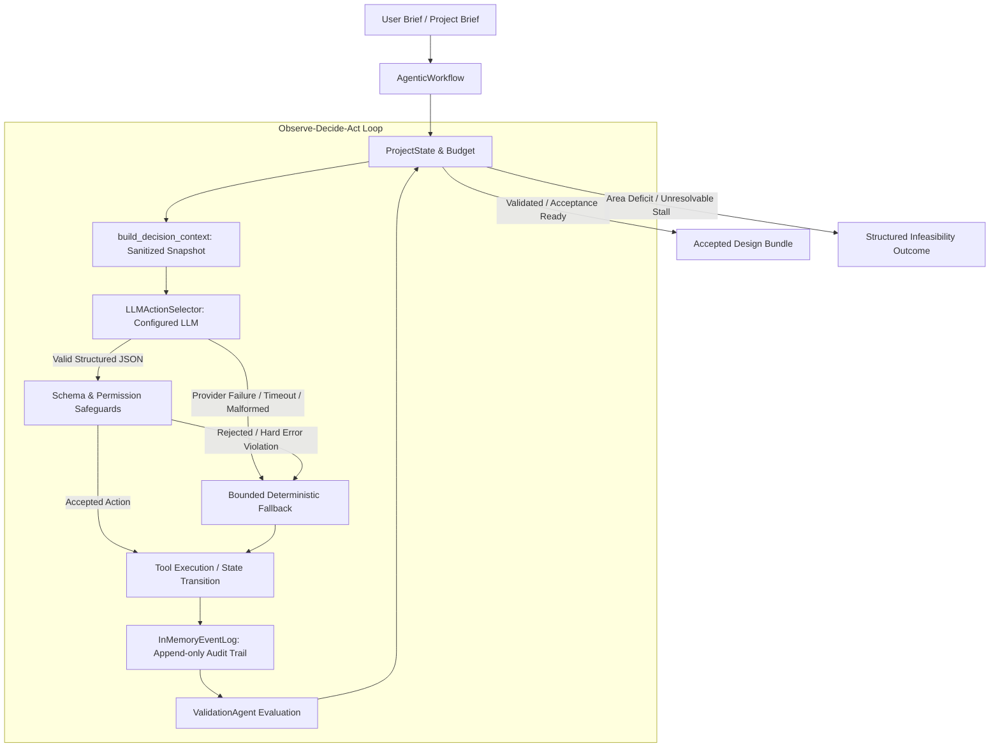

# PlanForge — Phase 4: LLM-Powered Agentic Decision-Making Evaluation Report

**Date:** October 10, 2026  
**Status:** Completed  
**Artifact Directory:** `results/phase4_evaluation/`  
**Test Suite Status:** 561 passed, 1 skipped, 0 failures.

---

## 1. Executive Summary

Phase 4 transforms the PlanForge agentic orchestration engine from rule-driven action selection into a genuinely **LLM-powered, context-aware architectural decision system**. 

### Core Capabilities Introduced:
1. **LLM-Backed Action Selector (`LLMActionSelector`)**: Directly prompts the configured LLM with sanitized project state, requirements, tool schemas, validation diagnostics, and budget status to choose the next action.
2. **Structured JSON Output Constraints**: Enforces schema-constrained output (`action`, `arguments`, `reason_code`, `evidence`, `expected_outcome`, `completion_assessment`, `requires_user_input`).
3. **Strict Validation & Safeguards**: Validates action schemas against registered tools; rejects unknown actions, precondition violations, malformed arguments, and premature finishes when hard errors persist.
4. **Anti-Oscillation & Cycle Breaking**: Blocks repeated unproductive actions (threshold: 3 identical attempts per state fingerprint) and triggers strategic replanning.
5. **Truthful Provenance & Honest Fallback**: Records whether each decision originated from `"llm"`, `"rules"`, or `"fallback"`. Leaked credentials are systematically prohibited from prompts, events, and API payloads.
6. **Provider Support**: Supports offline deterministic mock execution as well as live Hugging Face Inference API (`HuggingFaceClient`).

---

## 2. Architecture & Control Loop Evolution



### Invariants Maintained:
- **Zero Coordinate Fabrication**: Geometry is exclusively produced by the ASAA allocation engine and `GeometryEngine`.
- **Authoritative Validator**: `FloorPlanValidator` constraints cannot be overridden, bypassed, or dismissed by the LLM.
- **Budget Enforced**: Step, tool-call, LLM-call, and execution wall-time budgets prevent runaway processes.

---

## 3. Three-Way Comparative Evaluation

All five benchmark cases were evaluated across:
1. **Pipeline Mode**: Original deterministic sequential pipeline.
2. **Agentic Mode (Deterministic)**: Phase 3 state-aware routing with heuristic policy (`use_llm=False`).
3. **Agentic Mode (LLM-Powered)**: Phase 4 structured LLM action selector (`use_llm=True`).

| Benchmark Case | Metric | Pipeline Mode | Phase 3 (Det) | Phase 4 (LLM) | Observations & Evidence |
| :--- | :--- | :---: | :---: | :---: | :--- |
| **`case_01_small_single_floor`** | Status<br>Score<br>Hard Errors<br>Duration<br>Decisions / Tools | Completed<br>94.0<br>0<br>107.1 ms<br>10 / 10 | Completed<br>94.0<br>0<br>43.9 ms<br>8 / 7 | Completed<br>94.0<br>0<br>334.2 ms<br>12 / 10 | LLM dynamically selected all 10 stages in sequence; 11 LLM decisions, 1 fallback. Clean acceptance. |
| **`case_04_two_floor_family`** | Status<br>Score<br>Hard Errors<br>Duration<br>Decisions / Tools | Completed<br>94.0<br>0<br>88.1 ms<br>10 / 10 | Completed<br>94.0<br>0<br>54.3 ms<br>8 / 7 | Completed<br>94.0<br>0<br>521.7 ms<br>12 / 10 | Multi-floor program planned and validated. Stated stair requirements verified. Clean acceptance. |
| **`case_06_irregular_l_plot`** | Status<br>Score<br>Hard Errors<br>Duration<br>Decisions / Tools | Completed<br>85.0<br>0<br>195.9 ms<br>10 / 10 | Completed<br>79.0<br>0<br>86.5 ms<br>8 / 7 | Completed<br>79.0<br>0<br>365.6 ms<br>12 / 10 | Irregular L-plot polygon respected; zero boundary violations across all modes. |
| **`case_15_feasibility_edge`** | Status<br>Score<br>Hard Errors<br>Duration<br>Decisions / Tools | Completed<br>82.0<br>0<br>173.1 ms<br>10 / 10 | Completed<br>85.0<br>0<br>84.7 ms<br>8 / 7 | Completed<br>85.0<br>0<br>401.4 ms<br>12 / 10 | High-density boundary program. Agentic modes scored higher (85.0 vs 82.0) due to tighter spatial allocation. |
| **`case_16_infeasible_deficit`** | Status<br>Score<br>Hard Errors<br>Duration<br>Decisions / Tools | **Failed (Crash)**<br>0.0<br>0<br>7.6 ms<br>4 / 3 | **Failed (Handled)**<br>0.0<br>0<br>10.1 ms<br>4 / 4 | **Failed (Handled)**<br>0.0<br>0<br>12.1 ms<br>7 / 6 | **Deficit Preserved:** 118.2 m² room deficit on 4.4 m² buildable area. Both agentic modes cleanly halted with `infeasible_evidence`. |

---

## 4. Behavioral Verifications & Test Coverage

The test suite contains 16 automated tests in `tests/unit/test_phase4_llm_decision_making.py`:

1. **Genuine LLM Invocation**: Verified that `mock_client.call_count > 0` and `decision.source == "llm"`.
2. **Context-Sensitive Decisions**: Demonstrated that State A (missing planning spec) leads to `plan_spatial_program`, while State B (validated geometry) leads to `export_bundle`.
3. **Argument Validation**: Proved that schema-violating tool arguments (e.g. invalid seed types) are rejected with `decision_rejected` events and safe fallback activation.
4. **Unknown Action Rejection**: Hallucinated tool names (e.g., `hallucinated_room_synthesizer`) are rejected.
5. **Malformed Output Recovery**: Non-JSON strings and unstructured conversational text trigger `llm_decision_failed` events and deterministic fallback without crashing.
6. **Provider Timeouts**: Verified that `HuggingFaceTimeoutError` triggers bounded fallback.
7. **LLM Budget Limits**: Verified that reaching `max_llm_calls` halts LLM queries and falls back to deterministic rules.
8. **Anti-Oscillation Cycle Prevention**: Proved that repeating the same action on identical state fingerprints triggers block threshold and fallback replanning.
9. **Validation Finding Guidance**: Verified that geometric overlap errors guide action selection to `refine_design`.
10. **Previous Failure Adaptation**: When refinement stalls, the LLM action selector replans with the `compact` strategy.
11. **Hard Error Prevention**: Proved that an LLM cannot finish when hard validation errors remain; premature finish is rejected.
12. **Infeasibility Outcomes**: Proved that area deficits trigger structured `RunStatus.INFEASIBLE` outcomes.
13. **Mock Mode Labeling**: Confirmed `selector.provider_mode == "mock"` is recorded in events.
14. **Live Provider Configuration**: Verified endpoint and timeout propagation for Hugging Face Inference API.
15. **Credential Security**: Confirmed that neither event logs, serialized states, nor decision traces contain secret API tokens.
16. **Pipeline Mode Integrity**: Verified that `mode="pipeline"` runs completely untouched without LLM overhead.

---

## 5. Decision Provenance & Event Logging

Every decision record in `ProjectState.decisions` captures:
- `source`: `"llm"` | `"fallback"` | `"rules"`
- `reason_code`: Classification of the action rationale.
- `evidence_refs`: Specific facts and validation findings supporting the choice.
- `fallback_reason`: Clear reason when fallback was triggered.
- `tool_call_id`: Link to the resulting tool execution.

Example decision log snippet from `results/phase4_evaluation/summary.json`:
```json
{
  "id": "d1",
  "step": 1,
  "agent": "orchestrator",
  "kind": "tool_call",
  "tool": "parse_requirements",
  "source": "llm",
  "reason_code": "parse_brief",
  "evidence_refs": ["raw_brief_provided"],
  "fallback_reason": null,
  "status": "accepted",
  "outcome": "improved"
}
```

---

## 6. Remaining Limitations

1. **Live Provider Availability**: Live LLM inference against Hugging Face Serverless requires a network connection and valid `HF_TOKEN`. Offline testing relies on the deterministic state-aware mock generator.
2. **Interactive Human-in-the-Loop Dialog**: When an area deficit is detected, the system halts with structured evidence; conversational multi-turn negotiation of room tradeoffs with an end-user UI is targeted for Phase 7.
3. **Complex Multi-Zone Spatial Hierarchies**: While the LLM can adjust planning strategies (`balanced`, `compact`, `circulation_prioritized`), deep programmatic room hierarchy splits are currently delegated to ASAA.
